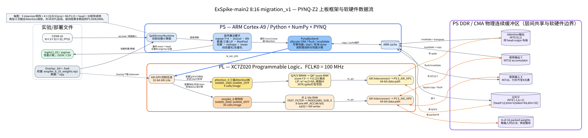
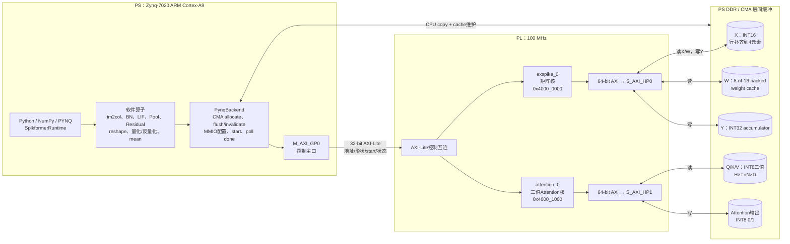
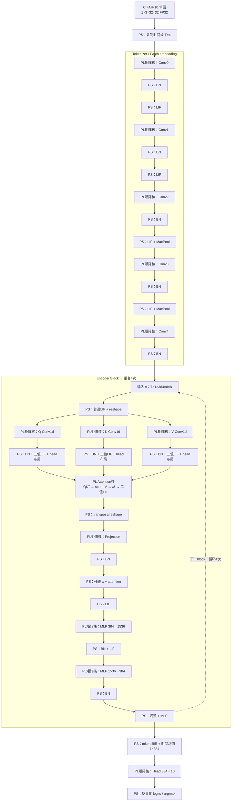
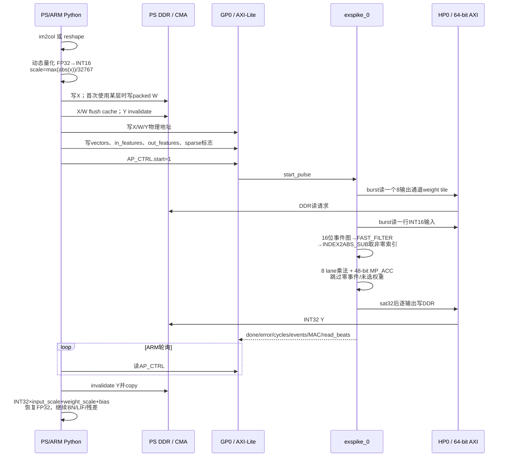
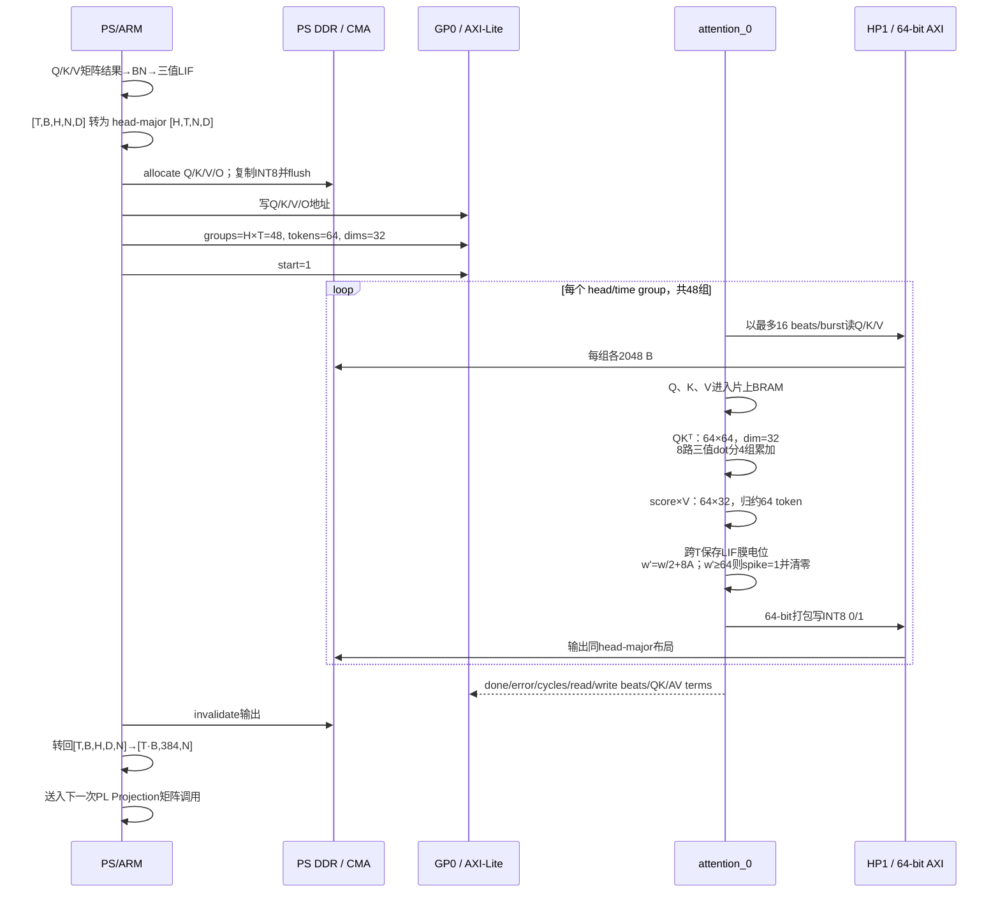
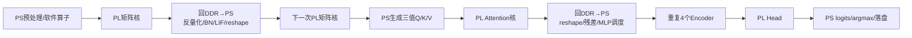
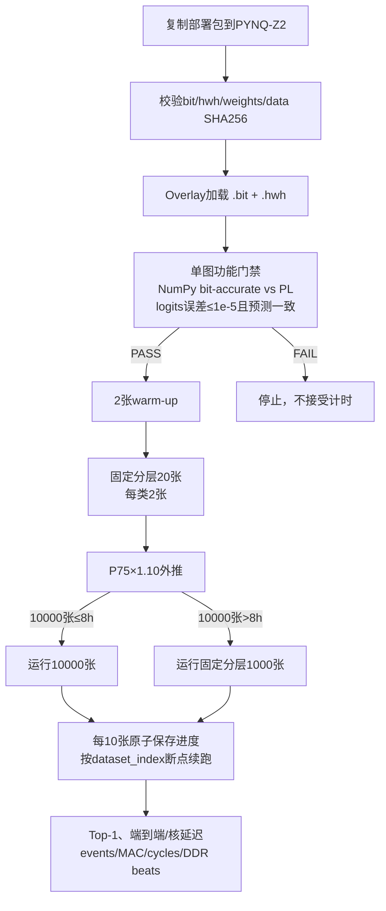

# ExSpike-main2 8:16 migration_v1 上板框架与数据流

> 依据本目录的 `board_runtime.py`、`vivado/build_overlay.tcl`、`rtl/exspike_z2_top.v`、`rtl/ternary_attention_top.v`、`.hwh` 和实际 pilot 结果整理。重点是“当前真实实现”，不是理想化的全流水 FINN 数据流架构。

## 1. 一眼看懂当前上板方式



核心结论：这是 **PS 主控 + DDR 中转 + 两个 PL 加速核** 的逐层协同执行。

- PS/ARM 保留完整模型调度，以及 im2col、BN、LIF、池化、残差、reshape、量化/反量化和最终均值。
- PL `exspike_0` 加速全部 Conv/Linear 的整数矩阵乘，共 30 次/图，经 PS7 `S_AXI_HP0` 访问 DDR。
- PL `attention_0` 加速 4 个 block 中的 `QK^T → score·V → ×0.125 → attention LIF`，共 4 次/图，经 `S_AXI_HP1` 访问 DDR。
- PS 通过 `M_AXI_GP0 → AXI-Lite` 写寄存器、启动核、轮询完成、读取错误码与计数器。
- 两个 PL 核之间没有 AXI-Stream 直连。中间张量经 CMA/PS DDR 返回 ARM，完成软件算子后再送往下一次 PL 调用。

## 2. 板级 PS/PL/DDR 互连



### 控制面与数据面

| 平面 | 主设备 → 从设备 | 位宽/地址 | 作用 |
|---|---|---|---|
| 控制面 | PS `M_AXI_GP0` → `exspike_0/s_axi_control` | AXI-Lite 32 bit，`0x40000000–0x40000FFF` | X/W/Y物理地址、vectors/in/out、稀疏标志、start/done、性能计数 |
| 控制面 | PS `M_AXI_GP0` → `attention_0/s_axi_control` | AXI-Lite 32 bit，`0x40001000–0x40001FFF` | Q/K/V/O物理地址、groups/tokens/dims、start/done、性能计数 |
| 数据面 | `exspike_0/m_axi` → PS `S_AXI_HP0` → DDR | AXI4 64 bit | 读取 INT16 输入和 packed 权重；写回 INT32 累加值 |
| 数据面 | `attention_0/m_axi` → PS `S_AXI_HP1` → DDR | AXI4 64 bit | 读取 INT8 Q/K/V；写回 INT8 spike |
| 时钟/复位 | PS7 `FCLK_CLK0` / Processor System Reset | 100 MHz / active-low | 两核、控制互连、数据互连共用时钟域 |

注意：HP0/HP1 是 PL 侧发起访问、进入 PS DDR 控制器的高性能从端口；不是 ARM 主动把数据“推”入核。ARM 先把 CMA 缓冲准备好并 flush，PL 再用物理地址主动读写 DDR。

## 3. 软件算法与 PL 的结合位置



调用计数来自代码路径本身：

| 模型区域 | 每次/每块 PL 调用 | 数量 | 每图调用 |
|---|---:|---:|---:|
| Tokenizer Conv0…4 | 1 个矩阵核 | 5层 | 5 |
| 每个 Encoder 的 Q/K/V、Projection、MLP1、MLP2 | 6 个矩阵核 | 4块 | 24 |
| 每个 Encoder 的融合 Attention | 1 个 Attention 核 | 4块 | 4 |
| 分类 Head | 1 个矩阵核 | 1层 | 1 |
| 合计 | 30 matrix + 4 attention | — | **34 次 PL 启动/图** |

## 4. 一次矩阵核调用的数据传输与计算



矩阵核的关键软硬件接口：

- 软件输入：`x` 为二维 `[vectors, in_features]`；卷积先由 ARM `im2col` 展开，Conv1d 先 transpose/reshape。
- 输入量化：每次调用动态计算单一 `xscale`，量化为 INT16；物理行补齐到 4 个 INT16 的倍数，以匹配 64-bit beat。
- 权重：离线存成每 8 个输出通道一 tile、每个输入特征 16 byte 的打包格式；第 0–7 byte 为 INT8 权重，第 8 byte 为 8-lane 选择 mask。驱动对每层权重 CMA 缓冲做缓存复用。
- 片上：输入 tile RAM、权重 tile RAM、selected-mask RAM；`FAST_FILTER + INDEX2ABS_SUB_0` 枚举非零激活，8 个 `MP_ACC` lane 累加。
- 输出：48-bit 累加饱和为 INT32 写 DDR；ARM 再做 `acc*xscale*wscale+bias`，所以 PL 不做浮点缩放、bias 或 BN。

## 5. 一次 Attention 核调用的数据传输与计算



固定真实张量形状为 `T=4, B=1, heads=12, tokens=64, dim=32`。每次调用给出 `groups=heads×time=48`，但 LIF 状态按同一 head 的 4 个时间步连续保存。融合整数公式与软件节点等价：

```text
A = (Q × K^T) × V
软件：v' = v/2 + A/16；v' >= 0.5 时 spike=1 且 v=0
硬件：w = 128v；w' = w/2 + 8A；w' >= 64 时 spike=1 且 w=0
```

这里的 `×0.125` 没有单独乘法器阶段，而是与 tau=2 的 LIF 更新合并为整数移位/加法。

## 6. 单图端到端时序与主要瓶颈



实际 20 图 pilot 平均值：

| 指标 | 实测 |
|---|---:|
| 端到端 | 16.895528 s/image |
| 全部 PL 核累计 | 7.146935 s/image |
| 30 次矩阵核 | 约 6.529 s/image |
| 4 次 Attention 核 | 约 0.618 s/image |
| 非 PL 核时间差值 | 约 9.749 s/image |
| 吞吐率 | 0.059187 image/s |

因此当前框架的主限制不只是 Attention 运算本身，而是：逐层 34 次启动、重复 CMA 分配/复制与 cache 维护、DDR 往返，以及 ARM 上的 im2col/BN/LIF/reshape/残差等。HP0 和 HP1 是独立物理端口，但当前 Python 计算图按依赖串行调用，未让两个核并行流水。

## 7. 上板实验流程



当前 pilot 的保守外推为 10000 张约 52.09 h，因此正式流程选择 1000 张子集，估算约 5.21 h。

## 8. 设计边界与阅读时容易误判的点

1. 这不是 FINN 生成的全网络 dataflow overlay；`SpikformerRuntime` 是 Python/NumPy 参考计算图，按层调用两个手写 RTL 核。
2. Attention 已真实迁到 PL，但 Q/K/V projection、BN 和三值 LIF 分别跨越矩阵核与 ARM；Attention 输出也回 ARM 后才送 Projection。
3. 原 ExSpike 的 `FAST_FILTER`、`INDEX2ABS_SUB_0` 和 `MP_ACC` 被复用/参数化；`ternary_attention_top` 是按本模型公式新增的核，不是原工程现成 Attention IP。
4. 矩阵核支持 8-of-16 packed 权重与事件跳零，但 tokenizer、projection、head 等层可关闭稀疏标志；实际层设置见 `weights_manifest.json`。
5. PL 内部是状态机式 DDR master + 片上 RAM，不是与整网各层常驻的 AXI-Stream 管线。

## 9. 代码到图中模块的索引

| 图中模块 | 代码/产物 |
|---|---|
| 模型调度与软件算子 | `board_runtime.py::SpikformerRuntime`、`im2col`、`batch_norm`、`lif`、`ternary_lif` |
| PYNQ驱动、CMA、寄存器协议 | `board_runtime.py::PynqBackend` |
| 矩阵核 | `rtl/exspike_z2_top.v` |
| 事件筛选/地址解码/累加 | `rtl/exspike/fast_filter.v`、`index2abs_sub.v`、`mp_acc.v` |
| Attention核 | `rtl/ternary_attention_top.v` |
| PS7、GP0、HP0、HP1与100MHz连接 | `vivado/build_overlay.tcl`、`exspike_migration_8_16.hwh` |
| 模型权重形状/稀疏层标记 | `weights_manifest.json` |
| 实测性能与调用计数 | `results/pilot_pynq_actual/pilot_results.json` |
| 上板实验入口 | `board_eval_exspike_main2_8_16_migration_v1.ipynb`、`board_pilot.py`、`board_eval_adaptive_runner.py` |

